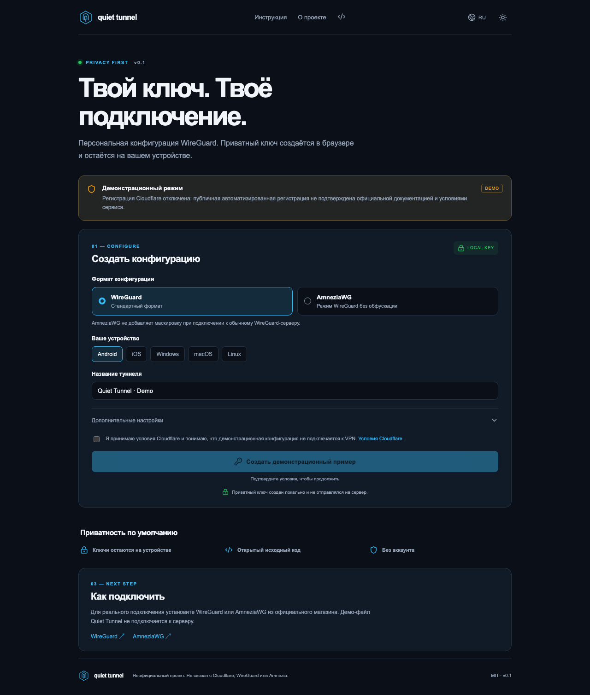

# Quiet Tunnel

**Your key. Your connection.**

Privacy-first open-source Cloudflare WARP configuration generator for WireGuard and compatible AmneziaWG clients.

**Live site:** https://quiet-tunnel.duckdns.org

> **Demo mode only.** Cloudflare's reviewed official documentation does not establish a public registration API or permission for public automated registration. Real generation is disabled. The generated `.conf` uses `demo.invalid`, is not a working VPN profile, and does not indicate a connected VPN.

Quiet Tunnel is an independent project, not an official Cloudflare, WireGuard, or AmneziaVPN product.

## Preview



## Features

- Russian/English responsive interface, dark/light theme.
- Browser-local X25519 keypair and QR rendering; no private key sent to the API or persisted to storage.
- Clearly marked demo `.conf` preview/download only.
- FastAPI health/capabilities and fail-closed registration endpoint.
- No accounts, analytics, database, ads, or real provider requests.

## Quick start

Requirements: Node.js 24+, Python 3.12+, npm.

```sh
cd frontend && npm ci && npm run dev
```

Backend, separately:

```sh
cd backend && python -m venv .venv && . .venv/bin/activate
pip install -r requirements.txt
uvicorn app.main:app --reload --port 8000
```

Compose is provided for VPS/local deployment; copy `.env.example` to `.env` and preserve demo mode.

## Test/build

```sh
cd frontend && npm ci && npm run lint && npx tsc --noEmit && npm run build
cd ../backend && pip install -r requirements.txt && pytest
```

## Limitations

Real WARP registration is disabled pending a supported, permitted public API. Demo profiles cannot connect. WireGuard format compatibility does not provide AmneziaWG obfuscation; both ends require compatible server parameters. Real VPN connectivity has not been tested because no real profile is issued.

Production updates/diagnostics use `scripts/update.sh`, `scripts/status.sh`, `scripts/logs.sh`, and `scripts/rollback.sh` from a Git checkout with `origin/main`. The production VPS runs the latest checked `main` checkout.

See [research](docs/RESEARCH.md), [security](docs/SECURITY.md), [privacy](docs/PRIVACY.md), and [deployment](docs/DEPLOYMENT.md). License: MIT.
