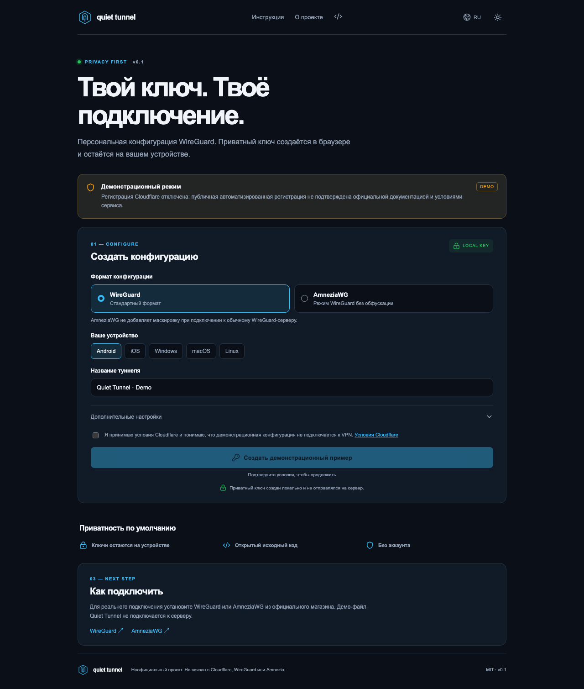

# Quiet Tunnel — Тихий туннель

**Твой ключ. Твоё подключение.**

Открытый генератор конфигураций Cloudflare WARP для WireGuard и совместимых клиентов AmneziaWG с приоритетом приватности.

**Сайт:** https://quiet-tunnel.duckdns.org

> **Только демо-режим.** В проверенной официальной документации Cloudflare не удалось подтвердить публичный API регистрации и разрешение на публичную автоматизированную регистрацию. Реальная генерация отключена. Демо-файл использует `demo.invalid`, не является рабочей VPN-конфигурацией и не означает, что VPN подключён.

Quiet Tunnel — независимый проект, не являющийся официальным продуктом Cloudflare, WireGuard или AmneziaVPN.

## Интерфейс



## Возможности

- Адаптивный интерфейс на русском и английском, светлая и тёмная темы.
- Локальная генерация пары X25519 и QR-кода. Приватный ключ не отправляется API и не сохраняется в браузерном хранилище.
- Только явно обозначенный демонстрационный файл `.conf`.
- FastAPI health/capabilities и закрытый по умолчанию endpoint регистрации.
- Без аккаунтов, аналитики, базы данных, рекламы и реальных запросов к провайдеру.

## Быстрый запуск

Нужны Node.js 24+, Python 3.12+, npm.

```sh
cd frontend && npm ci && npm run dev
```

Backend отдельно:

```sh
cd backend && python -m venv .venv && . .venv/bin/activate
pip install -r requirements.txt
uvicorn app.main:app --reload --port 8000
```

Для Compose скопируйте `.env.example` в `.env` и оставьте режим демо.

## Проверки

```sh
cd frontend && npm ci && npm run lint && npx tsc --noEmit && npm run build
cd ../backend && pip install -r requirements.txt && pytest
```

## Ограничения

Реальная регистрация WARP отключена, пока не будет подтверждён поддерживаемый публичный API и разрешённость его использования. Демо-профиль не подключается к VPN. Совместимость формата WireGuard сама по себе не даёт обфускацию AmneziaWG: для неё нужны совместимые параметры на обеих сторонах. Реальное VPN-подключение не тестировалось, поскольку приложение не выдаёт рабочий профиль.

Для обновления, диагностики и отката в Git checkout используйте `scripts/update.sh`, `scripts/status.sh`, `scripts/logs.sh` и `scripts/rollback.sh` с настроенным `origin/main`. Production VPS работает из текущего checkout ветки `main`.

Исследование: [RESEARCH](docs/RESEARCH.md). Безопасность: [SECURITY](docs/SECURITY.md). Приватность: [PRIVACY](docs/PRIVACY.md). Развёртывание: [DEPLOYMENT](docs/DEPLOYMENT.md). Лицензия MIT.
